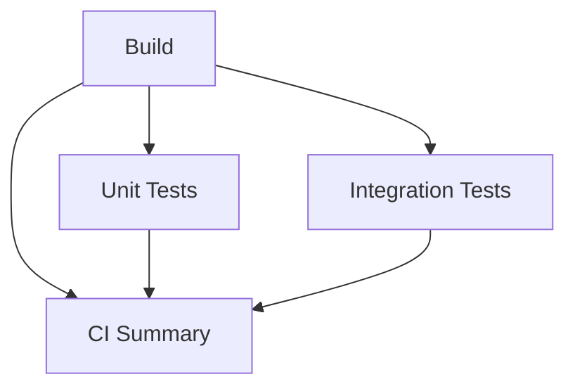

# CI learning guide

## 1. Workflow, job, step, runner

A **workflow** is an automated process declared in `.github/workflows/ci.yml`.
This one is named **CI**. Events start a workflow **run**:

- A push to `main`.
- A pull request opened, reopened, or updated targeting `main`.
- **Actions → CI → Run workflow** (manual dispatch, once the workflow is on the default branch).

A **job** is a sequence of **steps** executed on one **runner**. A runner is the
machine executing commands, not your development PC. Here GitHub provides a fresh
Ubuntu 24.04 virtual machine for each job and disposes it afterwards. Steps in a
job share that runner's filesystem; different jobs do not.

For example, a checkout action downloads the source to a runner. Setup .NET installs
SDKs/runtimes. A `run:` step executes `dotnet restore` or `dotnet test` in Bash.
This Bash is on Linux; the publishing examples below use Windows PowerShell.

## 2. The dependency graph



The YAML `needs: build` makes both test jobs wait for a successful Build. They
have no dependency on each other, so GitHub can schedule them concurrently (subject
to runner availability). Each restores and compiles its own project and API reference.

`needs: [build, unit_tests, integration_tests]` gives CI Summary the results of all
three jobs. `if: ${{ always() }}` allows it to run after failure or skipped jobs
instead of inheriting the normal success-only dependency behavior. The direct
Build dependency also lets the summary display the Build result.

The summary writes a Markdown table to `$GITHUB_STEP_SUMMARY`. It then explicitly
exits with code 1 if any required result is not `success`, including skipped or
cancelled dependencies. Test steps retain their failure status; no
`continue-on-error` masks a red test. A successful artifact upload cannot turn a
failed test job green. Force-cancelling a run can prevent remaining jobs from executing.

| Event | Build | Unit Tests | Integration Tests | CI Summary |
| --- | --- | --- | --- | --- |
| Everything passes | success | success | success | success |
| Compilation error | failure | skipped | skipped | failure |
| Unit assertion fails | success | failure | success or failure | failure |
| Integration assertion fails | success | success or failure | failure | failure |

## 3. SDK versus target framework versus runtime

- All three `.csproj` files target **net8.0**. That determines the application's API/runtime compatibility.
- `global.json` requests **SDK 9.0.314**, with `latestPatch` roll-forward within
  the 9.0.3xx feature band. The SDK builds the projects; it doesn't change their target framework.
- Running net8.0 tests needs **.NET 8**, and hosting the API needs **ASP.NET Core 8**.

Every build/test job uses official `actions/setup-dotnet@v6` with BOTH
`global-json-file: global.json` and `dotnet-version: '8.0.x'`. The action installs
an SDK satisfying global.json plus a .NET 8 SDK, whose installation includes the
8.x .NET/ASP.NET Core runtimes. We don't rely on the runner image keeping a particular
preinstalled runtime. `dotnet --info` in Build records the resolved environment.

Official actions used: checkout v7, setup-dotnet v6, upload-artifact v7. These are
maintained major releases verified when this workflow was prepared. `contents: read`
is the only workflow token permission; CI Summary needs none. Checkout does not
persist Git credentials. No repository secret is required for this CI.

### Why build again in test jobs?

Build's `bin/` and `obj/` exist only on Build's runner. Using `--no-build` in another
job would incorrectly assume those files were transferred. Instead each test job:

1. Checks out the same source revision.
2. Installs the configured SDK/runtime.
3. Restores with `--locked-mode`.
4. Runs `dotnet test --no-restore`, which **does compile** before executing tests.

This small solution doesn't need binary sharing or package caching to be useful.
`Directory.Build.props` enables NuGet lock files. The three committed
`packages.lock.json` files lock direct and transitive package versions. A changed
dependency graph makes locked restore fail until its lock file is updated intentionally.
After changing package references, run `dotnet restore BackendIntegrationLab.sln`
and include the resulting lock-file changes in the same commit.

## 4. What happens on a push or pull request?

1. GitHub receives the commit and checks the event/branch filters.
2. Build checks out the source. On a normal PR run, checkout tests GitHub's PR
   merge revision, checking compatibility with the target branch.
3. Restore downloads locked packages; build compiles the complete solution in Release.
4. After Build succeeds, Unit Tests and Integration Tests run on separate Linux runners.
5. Integration tests create their own API hosts and GUID-named SQLite files under
   the Linux temp directory, using `Path.GetTempPath()` and `Path.Combine()`.
   They need no Windows drive paths, database service or SQLite command-line utility.
   The NuGet SQLite provider supplies native Linux support.
6. All existing tests run without a filter, including the test-only SQLite trigger
   rollback case. The development database is never checked in or used by these tests.
7. Report-upload steps run with `always()` even when tests fail.
8. CI Summary displays the dependency results and enforces the final gate.

A push to a feature branch alone doesn't match the `main` push filter. Open a
pull request targeting `main` to run CI for that feature branch.

## 5. Reports, logs, and artifacts

| Job | Runner report path | Artifact name |
| --- | --- | --- |
| Unit Tests | `TestResults/Unit/unit-tests.trx` | `unit-test-results` |
| Integration Tests | `TestResults/Integration/integration-tests.trx` | `integration-test-results` |

The test commands use absolute results directories rooted in `github.workspace`;
upload patterns `TestResults/Unit/**/*.trx` and `TestResults/Integration/**/*.trx`
match those files from the repository root. Names are different so parallel uploads
do not conflict. Only TRX files are uploaded, not database files or the whole workspace.

TRX is Microsoft's XML test-result format. It includes individual tests, outcomes,
timings and failure details. Artifacts are downloadable ZIP files in the run's
**Artifacts** section and retained for **14 days**, subject to repository policy.
Extract one and open its `.trx` in Visual Studio, or inspect the XML with an editor.
The `dotnet test` step log also shows test totals and failed assertions.

If setup, restore, compilation, or a hard test-host crash prevents report creation,
the upload step warns that no report exists. The earlier failure remains red.
GitHub keeps step logs with the run according to repository log retention settings;
the job summary table is not an individual-test report.

To generate equivalent reports locally:

```powershell
dotnet restore BackendIntegrationLab.sln --locked-mode
dotnet build BackendIntegrationLab.sln --configuration Release --no-restore -p:ContinuousIntegrationBuild=true
dotnet test tests/BackendIntegrationLab.UnitTests --configuration Release --no-restore --logger "trx;LogFileName=unit-tests.trx" --results-directory "$PWD/TestResults/Unit"
dotnet test tests/BackendIntegrationLab.IntegrationTests --configuration Release --no-restore --logger "trx;LogFileName=integration-tests.trx" --results-directory "$PWD/TestResults/Integration"
```

Local Windows success verifies your code and commands; only the first hosted run
can confirm the complete GitHub/Linux workflow. The pipeline has not been run on
GitHub as part of this local preparation.

## 6. Publish BackendIntegrationLab to your personal GitHub

The local repository has been initialized on `main`. No commit, remote repository,
or push was created during preparation. The steps below are for you to execute
when you choose to publish.

### Prepare the first commit

1. Replace both `YOUR_GITHUB_USERNAME` occurrences in README's badge URLs with
   your personal GitHub username.
2. Run the restore/build/test commands above.
3. Inspect the proposed files:

   ```powershell
   Set-Location "C:\Users\z0048t6s\Desktop\Core_project\BackendIntegrationLab"
   git status --short --branch
   git status --short --ignored
   git check-ignore -v src/BackendIntegrationLab.Api/App_Data/banking.db
   git add --dry-run .
   ```

   `.gitignore` excludes bin/obj, App_Data, SQLite files/sidecars, test reports,
   local settings, common credential files and IDE state. Portable `.vscode`
   launch/tasks files are intentionally included. Shared `appsettings.json` and
   `launchSettings.json` contain public lab settings and are included.
   Ignore rules are not a secret scanner: review newly added configuration before committing.
   Already tracked files are not removed by later ignore changes.

4. Stage, inspect, then commit:

   ```powershell
   git add .
   git diff --cached --stat
   git diff --cached
   git status
   git commit -m "Add banking API, integration tests, and CI pipeline"
   ```

   If Git reports that your identity isn't configured, set your preferred identity
   yourself (your GitHub no-reply email can keep your personal email private).

### Create and publish (GitHub CLI)

GitHub CLI (`gh`) was not installed when this project was prepared. Install it
from https://cli.github.com/ (or `winget install --id GitHub.cli --exact`), then
open a new PowerShell terminal in the repository.

**These commands create a public GitHub repository and upload your commit. Run them
only when you are ready to publish:**

```powershell
gh auth login
gh auth status
# Replace this value with your personal account, not an organization:
$owner = 'YOUR_GITHUB_USERNAME'
gh repo create "$owner/BackendIntegrationLab" --public --source . --remote origin --description "ASP.NET Core banking API with NUnit HTTP/SQLite integration tests and GitHub Actions CI"
git remote -v
git push --set-upstream origin main
gh repo view --web
```

The remote repository must be empty; the CLI command does not add an extra README
or initialize a conflicting history. The first push triggers CI automatically.

## 7. Verify the first GitHub run

1. On your repository, open **Actions → CI → the run for your commit**.
2. Inspect the graph: Build fans out to Unit Tests and Integration Tests, which
   converge on CI Summary. Confirm both test jobs actually ran.
3. Open Build's **Show .NET environment** and check the SDK and .NET 8 runtimes.
4. Open each test job's test step: expect 4 unit tests and 10 integration cases,
   including `TransferMoney_DatabaseFailure_RollsBack` in the integration TRX.
5. Review the summary table and download both report artifacts. Confirm the badge
   points to your repository and reflects the run on `main`.
6. If red, read the first failing step before rerunning. Correct the cause locally,
   commit the fix, and push; that creates a new verification run.

Equivalent CLI inspection:

```powershell
gh run list --workflow ci.yml --limit 5
# Replace 123456789 with the actual run ID printed above:
gh run watch 123456789 --exit-status
gh run view 123456789
gh run view 123456789 --log-failed
gh run download 123456789 --dir TestResults/GitHub
```

After publication, you can manually rerun from **Actions → CI → Run workflow**,
or use `gh workflow run ci.yml --ref main`.

### Require CI before merging

After checks have run at least once:

1. Open **Settings → Branches → Add branch protection rule** (or an equivalent
   branch ruleset under **Settings → Rules → Rulesets**).
2. Target `main`. Enable **Require a pull request before merging** and
   **Require status checks to pass before merging**.
3. Select the observed check names **Build**, **Unit Tests**, **Integration Tests**,
   and **CI Summary** from GitHub Actions. The summary itself is a strict aggregate
   gate; requiring all four also makes each expectation explicit.
4. Optionally require the branch to be up to date before merging. Apply protection
   to administrators too if you want your own merges to demonstrate the same gate.
5. Save, then use feature branches and PRs rather than pushing directly to `main`.

Use the actual check labels shown on your first PR if GitHub displays them with a
workflow prefix. No path filters omit these required jobs. This workflow does not
configure merge-queue events; ordinary PR merges are the intended setup.

## 8. Demonstrate a failed pipeline on a separate branch

Start from a clean working tree and a published, green `main`:

```powershell
git switch main
git pull --ff-only
git switch -c demo/failing-integration-test
```

In `tests/BackendIntegrationLab.IntegrationTests/BankingApiTests.cs`, inside
`TransferMoney_ValidTransfer_UpdatesBothBalances`, temporarily change:

```csharp
await AssertBalances(source.Id, 400m, destination.Id, 150m);
```

to this deliberately wrong expectation:

```csharp
await AssertBalances(source.Id, 399m, destination.Id, 150m);
```

Run that test locally and observe its balance assertion fail:

```powershell
dotnet test tests/BackendIntegrationLab.IntegrationTests --filter "FullyQualifiedName~TransferMoney_ValidTransfer_UpdatesBothBalances"
git diff
git add tests/BackendIntegrationLab.IntegrationTests/BankingApiTests.cs
git commit -m "Demonstrate failing integration check"
git push --set-upstream origin demo/failing-integration-test
gh pr create --base main --head demo/failing-integration-test --title "Demo: failed integration check" --body "Intentional wrong balance expectation to demonstrate the CI failure path."
```

Opening the PR triggers CI. Build and Unit Tests should pass; Integration Tests
and CI Summary should fail. Download the integration report and inspect expected
399 versus actual 400. Required checks should block merging. Do not merge this demo.

Restore the expected balance to 400, run the test again, commit the correction,
and push to the same branch. The PR should receive a new green run. You can then
close the demonstration PR; its run history documents both outcomes without
introducing a deliberate failure into `main`.
