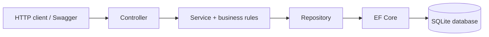
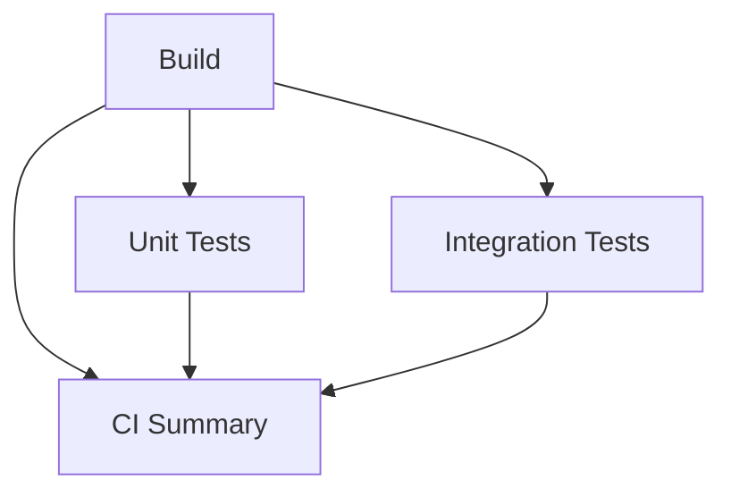

# BackendIntegrationLab

[](https://github.com/safag96/BackendIntegrationLab/actions/workflows/ci.yml)

An educational banking REST API demonstrating backend integration testing across
HTTP, business logic, EF Core, and a real SQLite database. It includes money
transfers with atomic transactions, isolated NUnit integration tests, and a
controlled database failure that verifies transaction rollback.

> Publishing setup: replace `YOUR_GITHUB_USERNAME` in the badge URLs with your
> GitHub username. The badge reflects GitHub execution only after publication.

## Technologies

- C# / ASP.NET Core **.NET 8**, controllers and dependency injection
- Entity Framework Core with **SQLite**; decimal money stored as exact integer cents
- **NUnit**, `Microsoft.AspNetCore.Mvc.Testing`, `WebApplicationFactory<Program>`
- Swagger / OpenAPI UI
- GitHub Actions on Ubuntu, TRX test reports, locked NuGet dependencies

## Architecture



| Endpoint | Purpose |
| --- | --- |
| `POST /api/accounts` | Create an account with an initial balance |
| `GET /api/accounts/{id}` | Retrieve account details |
| `POST /api/transfers` | Transfer money atomically between accounts |
| `GET /api/transfers` | Retrieve transfer history |

## Run locally

From the repository root, with SDK **9.0.314** (or a compatible 9.0.3xx patch
allowed by `global.json`) and the **.NET/ASP.NET Core 8 runtime** installed:

```powershell
dotnet restore BackendIntegrationLab.sln --locked-mode
dotnet build BackendIntegrationLab.sln --configuration Release --no-restore
dotnet run --project src/BackendIntegrationLab.Api --launch-profile http
```

Open **http://localhost:5080/swagger**. Stop with **Ctrl+C**.
`Banking.http` contains example requests. The local database is created at
`src/BackendIntegrationLab.Api/App_Data/banking.db` and excluded from Git.
No Docker, cloud services, or external database server are needed.

## Testing

```powershell
# All tests
dotnet test BackendIntegrationLab.sln --configuration Release

# Unit tests only
dotnet test tests/BackendIntegrationLab.UnitTests --configuration Release

# Integration tests only (no separately running API needed)
dotnet test tests/BackendIntegrationLab.IntegrationTests --configuration Release

# One integration test
dotnet test tests/BackendIntegrationLab.IntegrationTests --filter "FullyQualifiedName~TransferMoney_ValidTransfer_UpdatesBothBalances"
```

**Unit tests** call isolated business rules directly, without HTTP or a database.
**Integration tests** send HTTP requests through the real application pipeline
using `WebApplicationFactory`. Controllers, services, repository, EF Core, and
SQLite are real; TestServer replaces the network listener and each test receives
a new temporary SQLite file instead of the development database.

The suite covers creation, retrieval, transfers, validation, insufficient funds,
missing destinations, cent precision, and rollback after a real SQLite failure.
The rollback trigger exists only in its test's database.

## Continuous integration

Pushes to `main`, pull requests targeting `main`, and manual dispatch run this graph:



Test jobs run in parallel after Build. Each runner checks out source, installs
the SDK/runtime, restores locked dependencies, and compiles its own test project.
CI Summary runs even after failures and fails unless all three required jobs succeed.

In GitHub, open **Actions → CI → a run** to inspect the job graph, step logs, and
summary table. Download `unit-test-results` and `integration-test-results` from
**Artifacts** for TRX reports (14-day retention), including failed test results.
A failure before test execution may produce logs without a TRX file.

Local verification: **4 unit tests and 10 integration cases pass**. GitHub/Linux
execution must be verified after publication; local success is not a hosted CI result.

## Repository layout and learning resources

```text
.github/workflows/ci.yml                  Four-job CI workflow
src/BackendIntegrationLab.Api/             API, business rules, repository, EF Core
tests/BackendIntegrationLab.UnitTests/     Isolated business-rule tests
tests/BackendIntegrationLab.IntegrationTests/  HTTP + SQLite integration tests
Directory.Build.props                     NuGet lock-file generation
BackendIntegrationLab.sln                  Visual Studio solution
```

- [Backend learning guide](LEARNING_GUIDE.md): request tracing, manual experiments,
  Visual Studio/VS Code debugging, database reset, and break-it exercises.
- [CI learning guide](CI_LEARNING_GUIDE.md): runners, dependencies, publishing,
  first-run verification, required checks, and a failed-pipeline demonstration.

For your first debugging session, select
`TransferMoney_ValidTransfer_UpdatesBothBalances` and follow the guide's breakpoints
from controller through service to repository and transaction commit.
